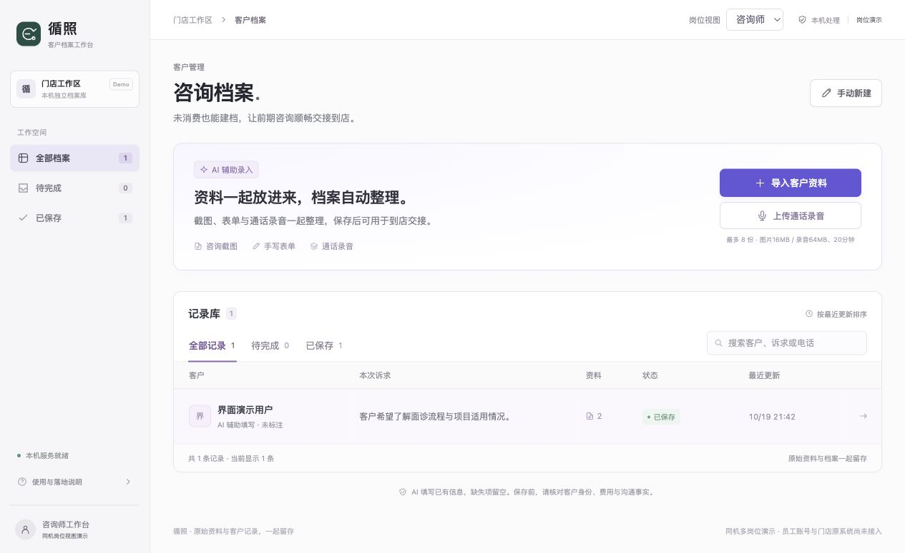
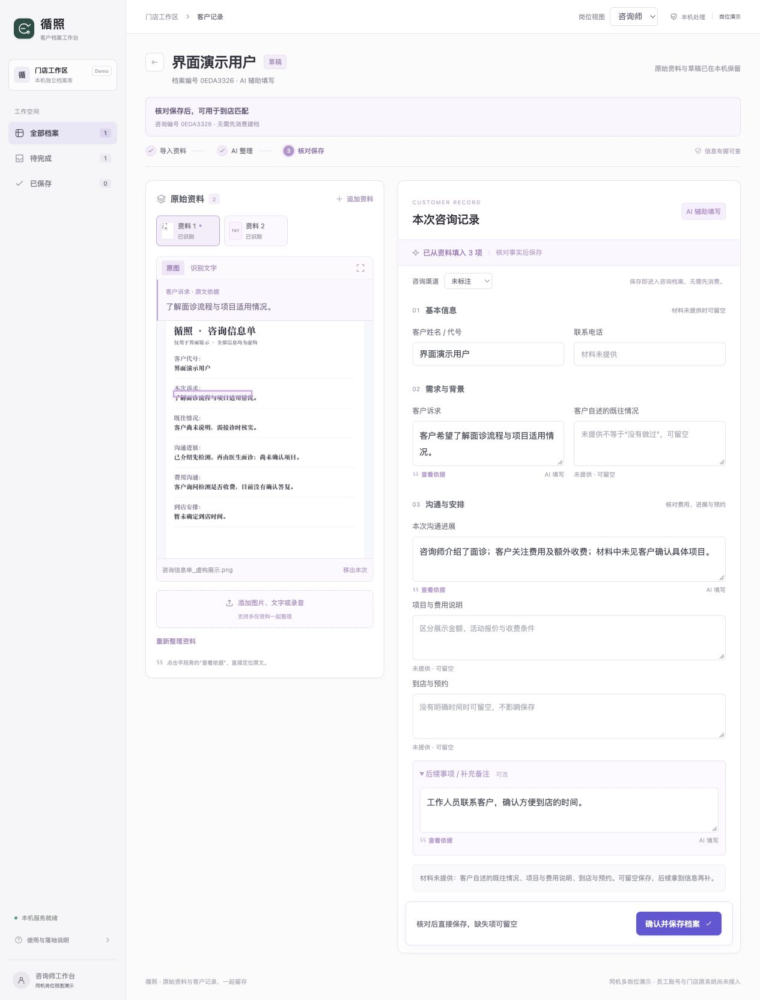
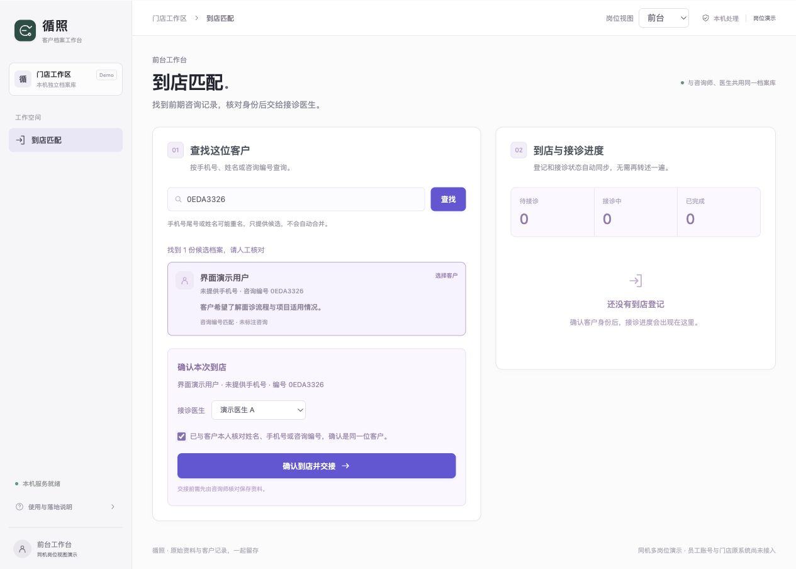
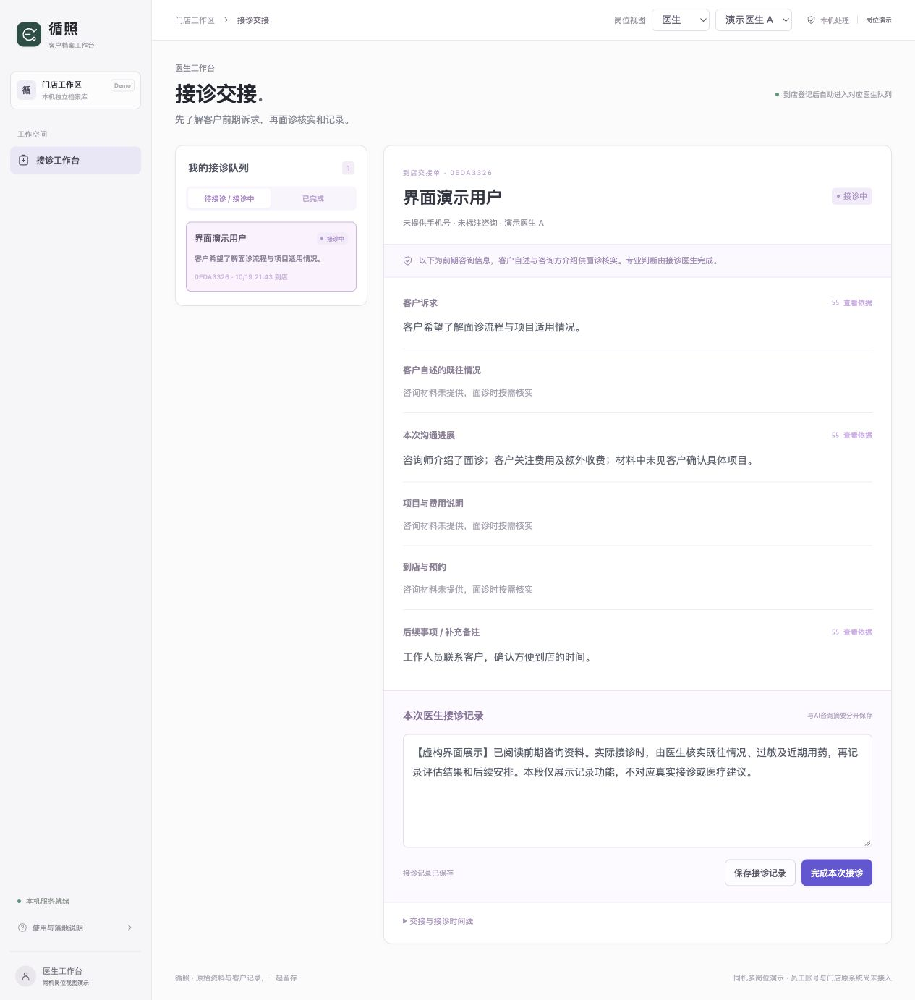

# 循照 Xunzhao

### 把前期咨询，接到到店接诊。

循照是一款在 Mac 本机运行的咨询档案工作台。把同一位客户的截图、表单照片、文字和录音放在一起，AI 辅助整理成可核对的咨询记录；客户到店后，前台匹配已有档案，医生接着查看前期沟通。

**图片识别 · 录音转写 · 信息整理 · 原文回查 · 到店匹配 · 医生接诊**

[快速开始](#快速开始) · [怎么使用](#怎么使用) · [界面预览](#界面预览) · [常见问题](#常见问题)



## 它有什么用

客户前期说过的情况，常常分散在聊天、电话和纸质记录里。到店换一个岗位接待，就可能需要再问一次、再转述一遍。

循照希望让这些信息接得上：咨询师先整理并核对，前台到店时找到记录，医生接诊前了解前期诉求。需要修改或确认的内容，可以回到原始材料核实。

| 工作环节 | 可以做什么 |
| --- | --- |
| 收集资料 | 同一位客户的多张图片、文字和录音一起导入，后续继续追加 |
| 整理信息 | 本机 OCR 和语音转写后，提取诉求、既往自述、沟通进展、费用及到店安排 |
| 人工核对 | 修改结果、补充信息，并回查原图、原文或录音片段；缺失项可以留空 |
| 到店交接 | 按姓名、手机号、手机尾号或咨询编号查找，人工确认身份后分配医生 |
| 医生接诊 | 阅读已保存的前期咨询，独立填写接诊记录，更新接诊状态 |
| 后续查找 | 原始资料与档案一同保留，支持搜索、筛选和再次打开 |

这是一套可以在本机实际运行的产品原型。是否能节省门店时间，仍需要结合真实业务流程和原系统接入情况验证，目前没有对外承诺提效比例。

## 快速开始

### 1. 准备运行环境

| 条件 | 要求 |
| --- | --- |
| 电脑 | Apple 芯片的 Mac，即 M 系列机型；当前本机模型方案不支持 Intel Mac 或 Windows |
| Python | 原生 Apple 芯片版本的 Python 3.10 或以上，建议使用 3.12 |
| Apple 命令行工具 | 提供 Swift 编译器，用于构建本机 OCR |
| 网络 | 首次安装依赖、下载约 2.6GB 模型时需要联网；准备完成后识别和整理在本机运行 |

Python 可从 [python.org](https://www.python.org/downloads/macos/) 安装。如果没有 Apple 命令行工具，在终端运行下面的命令，按系统提示完成安装：

```bash
xcode-select --install
```

### 2. 下载源码

在仓库顶部点击 **Code → Download ZIP**，下载后解压。

也可以使用 Git：

```bash
git clone https://github.com/zengzhimingz/xunzhao.git
cd xunzhao
```

### 3. 启动工作台

在解压后的目录中双击 **`启动客户档案.command`**。启动程序会检查环境，准备语言模型与语音模型，然后启动本机服务并打开浏览器。

如果双击没有执行，可在项目目录的终端中运行：

```bash
zsh 启动客户档案.command
```

首次准备的时间取决于网络和电脑性能，终端会显示进度。已经准备好的模型会保存在 `.runtime/`，后续启动继续使用，无需填写大模型 API Key。

服务启动后，访问 **<http://127.0.0.1:8770/>**。这是当前电脑的本机地址。

使用期间保持终端窗口打开；结束时在终端按 **Control + C** 停止服务。下次重新启动，已经保存的档案仍会保留。

## 怎么使用

### 咨询师：导入、核对、保存

1. 点击 **导入客户资料**，一次选择同一位客户的多份材料；录音也可以通过 **上传通话录音** 导入。
2. 等待本机识别和整理，查看右侧生成的咨询记录。
3. 对照左侧原始材料，修改错误、补充已确认内容；点击字段旁的 **查看依据**，可定位相关原文。
4. 录音支持按转写片段定位回听。姓名、电话、费用或到店时间没有提供时，可以留空。
5. 点击 **确认并保存档案**。后续有新材料，可打开同一份档案继续追加。

已有清楚的咨询内容时，也可以从 **手动新建** 开始记录，再补充材料。

### 前台：匹配客户、核对身份、分配医生

1. 右上角切换为 **前台**，按姓名、手机号、4 位手机尾号或咨询编号查找。
2. 选择候选档案，与到店客户人工核对身份。
3. 选择接诊医生，点击 **确认到店并交接**。

同名、同尾号只会展示候选，不会自动合并客户。交接使用已核对保存的档案；尚未开始接诊的登记可以撤销。

### 医生：查看咨询、独立记录、完成接诊

1. 切换为 **医生**，选择对应医生，打开队列中的到店客户。
2. 查看前期诉求、沟通进展和原始依据，再点击 **开始接诊**。
3. 手工填写本次核实结果与后续安排，保存记录或完成接诊。前台可以看到状态变化。

医生记录与 AI 整理的咨询信息分开保存，重新整理材料不会覆盖医生记录。涉及诊断、治疗或用药的判断，由医生完成。

## 界面预览

**以下为独立环境中的真实产品截图，展示信息均为虚构。仓库不附客户素材或业务数据，首次运行的记录库为空。**

### 原始材料与咨询记录一起核对

多份材料归入同一份档案，整理结果可以修改，也能回到原文核实。



### 到店匹配与岗位交接

前台先确认是同一位客户，再把已保存的咨询资料交给对应医生。



### 医生接诊与独立记录

医生直接查看前期沟通，面诊后填写自己的接诊记录。



## 支持的材料

| 类型 | 格式与限制 |
| --- | --- |
| 图片 | JPG、JPEG、PNG、WebP、HEIC、HEIF；单份不超过 16MB |
| 文字 | UTF-8 编码的 TXT、MD；每份不超过 18,000 字符，文件大小不超过 16MB |
| 录音 | WAV、MP3、M4A、AAC、FLAC、OGG、AMR；单份不超过 64MB、最长 20 分钟 |
| 每份档案 | 最多 8 份材料，可以一次导入或后续追加 |

当前不接收 PDF 或 Word 文件。图片清晰度、手写字体、噪声和口音都会影响识别结果，保存前需要人工核对。录音转写暂不自动区分说话人。

## 当前实现范围

- **已经具备：** 本机识别与整理、档案持久保存、原始资料回查、到店匹配、对应医生队列、独立接诊记录及版本冲突处理。
- **共享方式：** 同一台电脑、同一服务下的多个岗位视图。可以在多个浏览器标签页分别查看咨询师、前台和医生。
- **后续接入：** 微信或大众点评自动读取、通话自动录制、门店原有 CRM、多设备部署和正式员工账号权限，目前尚未接入。

岗位切换用于展示协作流程，不等于员工登录或生产环境的权限控制。

## 技术与目录

| 部分 | 使用的技术 |
| --- | --- |
| 前端 | 原生 HTML、CSS、JavaScript |
| 本机服务与存储 | Python HTTP 服务、SQLite |
| 图片识别 | Swift + Apple Vision |
| 咨询信息整理 | MLX + Qwen3 4B 本机模型 |
| 录音转写 | Faster Whisper small，本机 CPU 转写 |

```text
xunzhao/
├── index.html / styles.css      # 页面与样式
├── app.js / handoff-ui.js       # 档案编辑与岗位交接
├── server.py                   # 本机 API 服务
├── store.py / handoff.py        # 档案存储与接诊流程
├── ocr.swift                   # 本机图片文字识别
├── record_engine.py            # 咨询信息整理与依据校验
├── local_worker.py             # 本机语言模型进程
├── asr_engine.py / asr_worker.py # 录音解码与转写
├── 首次准备.py / 准备本机语音.py  # 模型与依赖准备
├── 启动.py / 启动客户档案.command # 服务启动入口
└── docs/images/                # 产品界面图
```

原始资料和档案运行时保存在 `.data/`；依赖、模型和 OCR 编译产物保存在 `.runtime/`。这两个目录都被 Git 忽略，不随源码上传。备份本机档案时，应完整保留 `.data/` 目录。

## 常见问题

**下载后双击 `index.html` 就可以用吗？**

请运行启动脚本。页面需要连接 Python 后端、本机 OCR 和模型环境，直接打开 HTML 文件无法完成识别与保存。

**提示找不到 Python 或 Swift，怎么办？**

安装 Apple 芯片版本的 Python 3.10+ 和 Apple 命令行工具，完成后重新运行启动脚本。启动终端会给出缺少哪项的提示。

**模型下载失败，怎么办？**

依赖通过 PyPI 安装，模型从 Hugging Face 下载。确认网络能够访问这些服务后重新启动；已准备的环境会继续使用。模型未准备完成时，AI 整理和录音转写无法正常使用。

**浏览器没有自动打开，怎么办？**

先确认终端已经显示服务启动成功，再手动访问 <http://127.0.0.1:8770/>。关闭服务终端后，这个地址将无法访问。

**需要付费 API Key 吗？客户资料会上传吗？**

当前版本无需外部大模型 API Key。图片识别、录音转写、语言模型整理与档案保存都在本机完成；首次准备环境时联网下载依赖和公开模型。
